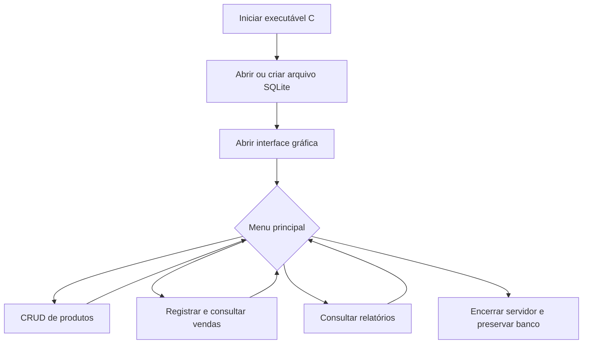
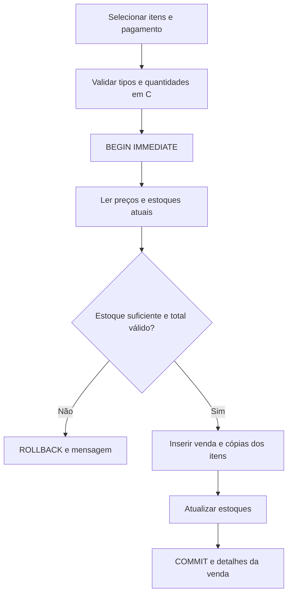

# Conferência do PDF — Sistema de controle de vendas

Fonte: `Projeto_Pratico_C_4_Pontos.pdf`, 4 páginas, lidas integralmente. A aplicação é em C11, dividida em `.c` e `.h`, e oferece interface gráfica no navegador. A interface gráfica usa Angular e TypeScript. Não há dependência de C++.

| Requisito obrigatório | Implementação | Evidência |
|---|---|---|
| 1. Menu organizado, retorno e encerramento | Navegação Produtos/Vendas/Relatórios, botões Voltar e Ctrl+C ou docker compose stop | `web/src/app.html`, teste de encerramento e testes UI |
| 2. Struct com cinco campos e identificador | `Product` contém ID, SKU, nome, categoria, preço, estoque e situação; `Sale` e `SaleItem` | `include/models.h` |
| 3. Cadastrar, listar, pesquisar, atualizar e excluir | CRUD completo de produtos; SKU único e ID automático | `src/views/produtos/`; testes API 02 e 03; testes UI de CRUD |
| 4. Pelo menos duas regras específicas | Cálculo da venda em centavos e baixa de estoque com validação de saldo | testes API 05, 06, 07 e 13 |
| 5. Condicionais e laços | validações `if`, menus via rotas, processamento de itens com `for`, servidor com `while` | `src/views/produtos/`, `src/views/vendas/criar_venda.c`, `src/server/http.c` |
| 6. Funções com responsabilidades definidas | servidor, persistência, regras, conversões e inicialização separados | `src/main.c`, `src/models/`, `src/server/`, `src/views/` |
| 7. Ponteiros e memória dinâmica | `SaleItem *items` com `calloc`; buffers com `malloc`; verificações e `free` em sucesso/falha | `src/views/vendas/criar_venda.c`, `src/server/http.c`; `make sanitize` |
| 8. Salvar e recuperar arquivos | SQLite em `data/vendas.db` com transações, WAL e integridade referencial | teste API 11, reinício real e `PRAGMA integrity_check` |
| 9. Validar entradas e IDs repetidos | campos obrigatórios, limites, tipos, SKU duplicado, datas, quantidades, pagamento e estoque | testes API 03, 04, 07, 09, 10 e 12; captura 05 |
| 10. Separação `.c` / `.h` e comentários | fontes organizados em models, server e views, cabeçalhos por responsabilidade e comentários de decisões relevantes | `src/`, `include/` |
| Interface gráfica indispensável | Interface Angular responsiva com formulários, tabelas e modais | 9 testes UI; capturas desktop e celular |

## Planejamento

Problema: organizar o cadastro de produtos e registrar vendas com cálculos corretos, evitando estoques negativos e perda de informações. Público: pequenos estabelecimentos e demonstração acadêmica. Entradas: produtos e itens de venda. Saídas: catálogo, histórico com detalhes da venda e total por período.

## Entregas e organização

| Entrega do enunciado | Arquivo |
|---|---|
| Fontes e software | `src/`, `include/`, `vendor/`, `web/`, `Makefile`, `iniciar.sh` |
| Relatório técnico em PDF | `docs/relatorio-tecnico.pdf` |
| Apresentação da aplicação | `docs/apresentacao.html` e `docs/apresentacao.pdf` |
| PowerPoint (versão anterior) | `docs/apresentacao.pptx` |
| README.txt | `README.txt` na raiz |
| Dados de exemplo | `data/exemplo.db` |
| Casos de teste e evidências | `tests/`, JSON e PNG em `artifacts/qa/` após executar os testes |
| Pasta compactada | `artifacts/entrega-controle-vendas.zip` |

O relatório inclui capa com identificação única da equipe, sumário com páginas, introdução, objetivos, requisitos, desenvolvimento, estruturas, fluxograma, funções, testes com resultados reais, manual, conclusão, referências e apêndice. Identificação recebida: Estácio S.A, turma 3003, professora Suzane Alfaia Dias; Rodrigo de Sousa Barbosa, Manoel de Sousa Santos, Lucas Robert Lopes Silva, Alan Freitas Miranda, Gabriel Henrique Maciel Leite e Jorge Igor Dos Santos Pinto. Curso e cidade permanecem campos a preencher em `docs/equipe.json`, pois não foram fornecidos. A divisão da equipe é uma proposta para validação; a participação real não é presumida. O PDF prevê cinco integrantes, mas foram informados seis: os seis nomes foram preservados, cabendo confirmar a composição com a professora.

O roteiro atual acompanha 11 slides sobre o propósito da aplicação, o uso das telas e as tecnologias utilizadas. A fala sugerida dura cerca de 12 minutos, com espaço adicional para demonstração e perguntas, e distribui a apresentação entre os seis integrantes informados. A avaliação individual exige que cada integrante compreenda a solução.

### Identificação dos integrantes

| Nome | Matrícula |
| --- | --- |
| Rodrigo de Sousa Barbosa | 202403618168 |
| Manoel de Sousa Santos | 202402239521 |
| Lucas Robert Lopes Silva | 201902231597 |
| Alan Freitas Miranda | 202404621073 |
| Gabriel Henrique Maciel Leite | 202403628988 |
| Jorge Igor Dos Santos Pinto | 202309399989 |
